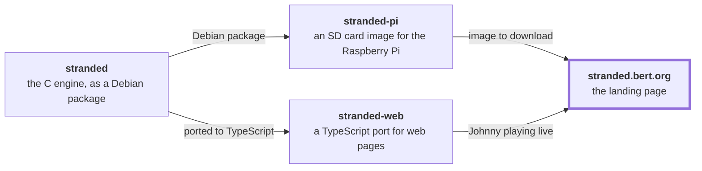

# stranded.bert.org

[stranded](https://github.com/bertrandom/stranded) · [stranded-pi](https://github.com/bertrandom/stranded-pi) · [stranded-web](https://github.com/bertrandom/stranded-web) · [stranded.bert.org](https://github.com/bertrandom/stranded.bert.org)

The landing page for [stranded-pi](https://github.com/bertrandom/stranded-pi), with Johnny Castaway playing live across the top, from [stranded-web](https://github.com/bertrandom/stranded-web).

## Building it

stranded-web is a dependency from `../stranded-web`, so it needs to be built first:

    (cd ../stranded-web && npm install && npm run build)
    npm install
    npm run data -- <directory with RESOURCE.MAP>
    npm run build

`npm run data` converts the original game's data files into `public/data` (see [stranded-web's README](https://github.com/bertrandom/stranded-web#the-games-data)). They aren't in this repository.

`dist` is then the whole site, data included, for any static host. `npm run dev` serves it while working on it.

## License

GPL v3 or later, as stranded and stranded-web.
